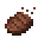

# Eating Animation Continued

An unofficial continuation of [Eating Animation](https://modrinth.com/mod/eating-animation) by theone_ss, for Minecraft 1.21.4 through 26.3 on Fabric.

A small client side mod that plays a sprite animation in your hand when you eat or drink. Food shrinks bite by bite, and potions, milk and honey empty as you drink them. It also animates for other players you can see, and the hotbar icon stays normal.

Download it on [Modrinth](https://modrinth.com/mod/eatinganimationcontinued).

## Versions

Each range of Minecraft versions has its own branch.

| Minecraft | Branch |
|---|---|
| 26.3 | [main](https://github.com/22yrs/EatingAnimationContinued/tree/main) |
| 26.1 to 26.2 | [26.1-26.2](https://github.com/22yrs/EatingAnimationContinued/tree/26.1-26.2) |
| 1.21.9 to 1.21.11 | [1.21.9-1.21.11](https://github.com/22yrs/EatingAnimationContinued/tree/1.21.9-1.21.11) |
| 1.21.4 to 1.21.8 | [1.21.4-1.21.8](https://github.com/22yrs/EatingAnimationContinued/tree/1.21.4-1.21.8) |

## Requirements

- Fabric Loader 0.16.10 or newer on 1.21, or 0.20.0 or newer on 26.x
- Fabric API

## Credits

All animation textures and the original mod are by **theone_ss**, spusik_, PinkGoosik and DoctorNight1. This port moves the mod to the item model system Minecraft has used since 1.21.4. Originals: [Modrinth](https://modrinth.com/mod/eating-animation) | [GitHub](https://github.com/Theoness1/EatingAnimation)

The original author also makes [Theone's Eating Animation Pack](https://modrinth.com/resourcepack/theones-eating-animation-pack), which adds the same animations as a resource pack. If you'd rather not use a mod, that pack is the way to go.

## Resource Packs

A resource pack that only retextures food still gets this mod's default eating sprites. A pack that replaces a food's item model also replaces its animation.

## License

MIT, the same as the original. See [LICENSE](LICENSE).
